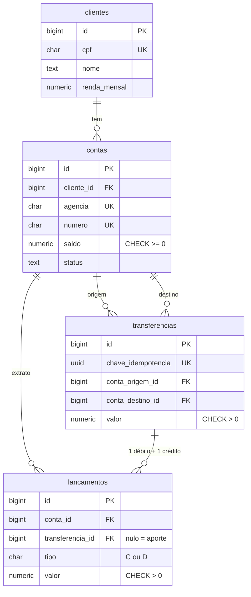

# 1️⃣ Lab 1 — Modelagem e implementação

> ⬅️ [README principal](../../README.md) · Lab 1 de 3 · ⏱️ 180 min

> **A pergunta do banco:** "Como garantir que uma transferência nunca debita
> sem creditar, nem roda duas vezes?"

Você recebe os requisitos do serviço de contas e transferências, desenha o
modelo no dbdiagram.io, implementa o banco com o SQL de referência e prova,
com consultas, que as regras se sustentam e que o extrato é rápido.

**Objetivos**

* transformar requisitos e padrões de acesso num modelo relacional;
* entender cada restrição (`PRIMARY KEY`, `FOREIGN KEY`, `UNIQUE`, `CHECK`) como uma regra de negócio;
* ver uma transferência ser atômica, desfeita no erro e idempotente;
* medir uma consulta antes e depois de um índice com `EXPLAIN ANALYZE`;
* registrar as decisões num ADR curto.

**Pré-requisitos:** o [preflight](../../README.md#4-rode-o-preflight)
feito e um navegador. Nada de SQL avançado: tudo que você roda já está
pronto, e o roteiro explica cada linha que importa.

| Seção | Atividade | Tempo |
|---|---|---|
| [1.1](#11-preparação-e-o-caso) | Preparação e apresentação do caso | 15 min |
| [1.2](#12-modelagem-no-dbdiagramio) | Modelagem no dbdiagram.io | 40 min |
| [1.3](#13-exportação-e-revisão) a [1.6](#16-a-carga-sintética) | Exportação, revisão e execução do SQL | 35 min |
| [1.7](#17-as-restrições-trabalhando) e [1.8](#18-a-transferência-atômica) | Restrições e transferência transacional | 35 min |
| [1.9](#19-consultas-índices-e-planos-de-execução) | Consultas, índices e planos de execução | 35 min |
| [1.10](#110-validação-e-justificativa-o-adr) | Validação e justificativa das decisões | 20 min |

---

## 1.1 Preparação e o caso

⏱️ 15 min

🖥️ **No seu terminal**, na pasta do repositório:

<!-- rodar: shell -->
```bash
make subir
make status
```

```
...
  Tudo no ar. Veja onde voce parou com: make status

  producao   no ar   PostgreSQL 17.11   banco_sudoers: 7510 kB   porta 5470

  Lab 1  ⬜ modelo   ⬜ transferência   ⬜ carga   ⬜ índices
...
```

O banco `banco_sudoers` existe, mas está vazio. Antes de criar qualquer
tabela, leia o caso.

### O enunciado

O Banco Sudoers vai lançar um serviço de **transferências internas** (entre
contas do próprio banco) com **extrato**. O time de produto passou estes
requisitos:

| # | Regra de negócio |
|---|---|
| R1 | Um **cliente** tem nome, CPF (único), e-mail, telefone, data de nascimento e renda mensal informada. |
| R2 | Um cliente pode ter **uma ou mais contas**. Toda conta pertence a exatamente um cliente. |
| R3 | A conta é identificada por **agência (4 dígitos) + número (6 dígitos)**, únicos juntos. |
| R4 | A conta tem **saldo** e **situação**: ativa, bloqueada ou encerrada. Só conta **ativa** envia ou recebe. |
| R5 | Uma **transferência** tem conta de origem, conta de destino (diferentes), valor e descrição opcional. |
| R6 | O valor é em reais, **maior que zero**, com **no máximo 2 casas decimais**. Não pode haver erro de arredondamento. |
| R7 | **Sem cheque especial**: a conta nunca fica com saldo negativo. Sem saldo, a transferência é recusada. |
| R8 | Débito na origem e crédito no destino acontecem **juntos ou não acontecem**. |
| R9 | O app pode reenviar a mesma solicitação (rede caiu, cliente clicou duas vezes). A mesma solicitação **nunca** é processada duas vezes. |
| R10 | O extrato mostra cada movimento da conta: data, tipo (crédito ou débito), valor e a transferência de origem. |

E estes **padrões de acesso**, o que o sistema mais vai perguntar ao banco:

| # | Consulta | Frequência |
|---|---|---|
| P1 | Extrato de **uma conta** num **período** (o mês, os últimos 30 dias) | altíssima: toda abertura do app |
| P2 | Saldo de uma conta | altíssima |
| P3 | Uma transferência pela chave da solicitação (para responder ao reenvio) | alta |
| P4 | Transferências de uma conta (enviadas e recebidas) num período | média: atendimento e auditoria |

### Simplificações didáticas

Um banco de verdade tem muito mais. Aqui, de propósito:

* só **transferência interna**, sem PIX, TED, boleto, tarifa, limite ou agendamento;
* o dinheiro "de fora" entra por **aportes**: um crédito sem transferência, feito na abertura da conta;
* uma moeda só (real) e nenhum juro;
* o "app" é simulado: você chama a função de transferência pelo psql, e o `make carga` faz o papel de muitos clientes ao mesmo tempo;
* todos os dados são **sintéticos**. O CPF tem o dígito verificador errado de propósito e nunca coincide com o de uma pessoa real.

---

## 1.2 Modelagem no dbdiagram.io

⏱️ 40 min · em dupla, se o instrutor pedir

Agora é com você: desenhe o modelo que atende R1 a R10 e P1 a P4. O
[dbdiagram.io](https://dbdiagram.io/d) desenha o diagrama a partir de um
texto chamado **DBML**. É gratuito e não precisa de conta para desenhar.
Para salvar online, entre com uma conta gratuita. Ou simplesmente copie o
texto para um arquivo, como no fim desta seção.

🌐 **No dbdiagram:** abra https://dbdiagram.io/d e apague o exemplo do
painel da esquerda. Escreva o seu modelo. A sintaxe que você precisa cabe
neste exemplo:

```text
Table exemplo {
  id bigint [pk, increment]          // chave primária com numeração automática
  codigo char(4) [not null, unique]  // obrigatório e sem repetição
  valor "numeric(15,2)" [not null]   // tipo com parênteses vai entre aspas
  outra_id bigint [ref: > outra.id]  // chave estrangeira: muitos "exemplo" para um "outra"
  criado_em timestamptz [default: `now()`]

  indexes {
    (outra_id, criado_em)            // índice composto
  }
  Note: 'regras que o DBML não desenha (CHECK) podem ir em notas'
}
```

Um caminho que funciona:

1. **Entidades.** Que "coisas" os requisitos citam? Uma tabela para cada.
2. **Chaves.** Como identificar cada linha? E o que precisa ser único (R1, R3, R9)?
3. **Relacionamentos.** Quem aponta para quem (R2, R5)? Um para muitos?
4. **Tipos.** Que tipo guarda dinheiro sem erro de arredondamento (R6)?
5. **Regras.** R4, R6 e R7 viram restrições. Anote-as em `Note`.
6. **O extrato (R10, P1).** Ele é uma tabela própria ou uma consulta? E o saldo (P2): você guarda ou calcula?
7. **A repetição (R9).** O que, no modelo, impede processar duas vezes a mesma solicitação?
8. **Índices.** Para cada padrão de acesso, qual coluna o banco vai procurar?

> Não existe um único modelo certo. Anote no caderno **por que** você
> escolheu cada coisa: isso vira o seu ADR na seção 1.10.

**Checkpoint.** Quando o seu modelo estiver de pé, guarde o texto: copie o
DBML do painel da esquerda e cole num arquivo `entregas/meu_modelo.dbml`
(abra a pasta do repositório no seu editor; no Windows, veja a dica de
editor no [guia](../../docs/windows.md)).

### Compare com a referência

🌐 **No dbdiagram:** abra uma **segunda aba** em https://dbdiagram.io/d,
apague o exemplo e cole o conteúdo de
[`modelo/banco_sudoers.dbml`](../../modelo/banco_sudoers.dbml). Esse é o
modelo de referência que os três labs usam. O desenho dele:



(Se o dbdiagram estiver fora do ar ou bloqueado na sua rede, use este
desenho e o arquivo `.dbml` no seu editor: dá para fazer a seção inteira.)

Compare com o seu e responda no caderno (as respostas vão para o ADR):

1. A referência guarda o saldo **e** os lançamentos. Que vantagem isso dá ao P2? E que risco cria?
2. Por que `numeric(15,2)` e não `float` (nem o tipo `money`)?
3. Por que a chave de idempotência é `uuid` e quem a gera?
4. Por que o extrato (`lancamentos`) tem `transferencia_id` **nulo** em alguns casos?
5. O que o seu modelo tem que a referência não tem? Isso faria falta?

---

## 1.3 Exportação e revisão

⏱️ dentro dos 35 min das seções 1.3 a 1.6

🌐 **No dbdiagram**, na aba do **seu** modelo: menu **Export** →
**PostgreSQL**. Abra o arquivo `.sql` baixado no editor, ao lado de
[`labs/1_modelagem/sql/01_schema.sql`](./sql/01_schema.sql), o SQL de
referência.

Procure no SQL exportado:

* os **`CHECK`** (saldo não negativo, valor positivo, origem diferente de destino). O export do DBML **não gera** `CHECK`: as regras R6 e R7 ficaram só no papel;
* a **função de transferência**. Também não está lá: modelo de dados descreve tabelas, não o comportamento.

Por isso o banco dos labs é criado pelo **SQL de referência**, e não pelo
seu export. O seu modelo é o seu raciocínio. O SQL de referência é o
contrato que os labs 2 e 3 esperam encontrar.

> **Rode o SQL de referência seja qual for o seu modelo.** Você não precisa
> deixar o seu desenho igual ao da referência. Basta saber explicar as
> diferenças (pergunta 5).

---

## 1.4 Criando o modelo

Abra [`sql/01_schema.sql`](./sql/01_schema.sql) no editor e leia. Os
comentários explicam cada tabela. Depois rode:

🖥️ **No seu terminal:**

<!-- rodar: shell -->
```bash
make sql f=labs/1_modelagem/sql/01_schema.sql
```

```
DROP SCHEMA
CREATE SCHEMA
ALTER DATABASE
SET
CREATE TABLE
CREATE TABLE
CREATE TABLE
CREATE TABLE
...
Modelo criado: clientes, contas, transferencias, lancamentos (schema banco).
```

> Este arquivo **recomeça do zero**: rodar de novo apaga o schema `banco`
> e tudo dentro dele. Útil se algo der errado no meio do lab.

Entre no banco e olhe uma tabela por dentro.

🖥️ **No seu terminal:**

```bash
make psql
```

🐘 **No psql:**

<!-- rodar: producao -->
```sql
\dt
\d contas
```

```
             List of relations
 Schema |      Name      | Type  |  Owner
--------+----------------+-------+---------
 banco  | clientes       | table | sudoers
 banco  | contas         | table | sudoers
 banco  | lancamentos    | table | sudoers
 banco  | transferencias | table | sudoers
(4 rows)

                                    Table "banco.contas"
   Column   |           Type           | Collation | Nullable |           Default
------------+--------------------------+-----------+----------+------------------------------
 id         | bigint                   |           | not null | generated always as identity
 cliente_id | bigint                   |           | not null |
 agencia    | character(4)             |           | not null |
 numero     | character(6)             |           | not null |
 saldo      | numeric(15,2)            |           | not null | 0
 status     | text                     |           | not null | 'ativa'::text
 aberta_em  | timestamp with time zone |           | not null | now()
Indexes:
    "contas_pkey" PRIMARY KEY, btree (id)
    "contas_agencia_numero_key" UNIQUE CONSTRAINT, btree (agencia, numero)
Check constraints:
    "contas_agencia_check" CHECK (agencia ~ '^[0-9]{4}$'::text)
    "contas_numero_check" CHECK (numero ~ '^[0-9]{6}$'::text)
    "contas_saldo_check" CHECK (saldo >= 0::numeric)
    "contas_status_check" CHECK (status = ANY (ARRAY['ativa'::text, 'bloqueada'::text, 'encerrada'::text]))
Foreign-key constraints:
    "contas_cliente_id_fkey" FOREIGN KEY (cliente_id) REFERENCES clientes(id)
Referenced by:
    TABLE "lancamentos" CONSTRAINT "lancamentos_conta_id_fkey" FOREIGN KEY (conta_id) REFERENCES contas(id)
    TABLE "transferencias" CONSTRAINT "transferencias_conta_destino_id_fkey" FOREIGN KEY (conta_destino_id) REFERENCES contas(id)
    TABLE "transferencias" CONSTRAINT "transferencias_conta_origem_id_fkey" FOREIGN KEY (conta_origem_id) REFERENCES contas(id)
```

Cada linha de `Check constraints` é uma regra de negócio que o **banco**
garante, venha o dado do app, de um script ou de alguém no psql. Repare
também: a `PRIMARY KEY` e o `UNIQUE` ganharam índice sozinhos (`Indexes`),
mas a chave estrangeira `cliente_id` **não**. Guarde isso para a seção 1.9.

---

## 1.5 A transferência e a auditoria

Abra [`sql/02_transferencia.sql`](./sql/02_transferencia.sql) e leia a
função `banco.transferir`. Ela tem cinco passos comentados: validar o
valor, travar as contas, registrar a solicitação (idempotência), checar as
regras e mover o dinheiro. Abaixo dela está `banco.auditoria()`, que confere
as **invariantes financeiras**:

| # | Invariante | Por que importa |
|---|---|---|
| 1 | saldo de cada conta = créditos − débitos do extrato | o saldo guardado não pode divergir do extrato |
| 2 | cada transferência tem 1 débito na origem e 1 crédito no destino, de mesmo valor | nenhuma transferência pela metade |
| 3 | soma de todos os saldos = soma dos aportes | transferência interna não cria nem some com dinheiro |
| 4 | nenhum saldo negativo | R7 |

🖥️ **No seu terminal** (em outra janela, ou saia do psql com `\q`):

<!-- rodar: shell -->
```bash
make sql f=labs/1_modelagem/sql/02_transferencia.sql
```

```
SET
CREATE FUNCTION
COMMENT
CREATE FUNCTION
COMMENT

Funções criadas: banco.transferir(...) e banco.auditoria().
```

---

## 1.6 A carga sintética

[`sql/03_carga.sql`](./sql/03_carga.sql) gera 12 meses de movimento: 10 mil
clientes, 12 mil contas e 400 mil transferências (800 mil lançamentos).
Leva de 10 a 40 segundos.

🖥️ **No seu terminal:**

<!-- rodar: shell -->
```bash
make sql f=labs/1_modelagem/sql/03_carga.sql
```

```
...
 clientes | contas | transferencias | lancamentos
----------+--------+----------------+-------------
    10000 |  12000 |         400000 |      812000
(1 row)
```

São 800 mil lançamentos das transferências mais 12 mil aportes, um por
conta. Confira as invariantes.

🐘 **No psql** (`make psql`):

<!-- rodar: producao -->
```sql
SELECT * FROM auditoria();
```

```
                  regra                  | ok |                  detalhe
-----------------------------------------+----+--------------------------------------------
 1. saldo = créditos - débitos           | t  | 0 conta(s) divergente(s)
 2. transferência = 1 débito + 1 crédito | t  | 0 transferência(s) sem os dois lançamentos
 3. soma dos saldos = soma dos aportes   | t  | saldos 722365914.27 / aportes 722365914.27
 4. nenhum saldo negativo                | t  | 0 conta(s) negativa(s)
(4 rows)
```

Quatro `t`: o banco nasce íntegro. Você vai rodar essa auditoria depois de
cada coisa que fizer nos três labs.

**📍 Checkpoint 1.6:** modelo, função e carga no lugar. Se a aula acabar
aqui, `make derruba` guarda tudo. Se algo deu errado, rode de novo os três
`make sql` acima, na ordem.

---

## 1.7 As restrições trabalhando

⏱️ dentro dos 35 min das seções 1.7 e 1.8

Tente quebrar as regras **direto nas tabelas**, como faria um script com
defeito. Cada comando abaixo **deve falhar**: o erro é a prova.

🐘 **No psql:**

<!-- rodar: producao falha-esperada -->
```sql
UPDATE contas SET saldo = -50 WHERE id = 1;
```

```
ERROR:  new row for relation "contas" violates check constraint "contas_saldo_check"
DETAIL:  Failing row contains (1, 1, 0002, 100007, -50.00, ativa, 2025-09-18 01:13:02.860766-03).
```

<!-- rodar: producao falha-esperada -->
```sql
INSERT INTO transferencias (chave_idempotencia, conta_origem_id, conta_destino_id, valor)
VALUES (gen_random_uuid(), 1, 1, 10);
```

```
ERROR:  new row for relation "transferencias" violates check constraint "transferencias_check"
```

<!-- rodar: producao falha-esperada -->
```sql
INSERT INTO lancamentos (conta_id, tipo, valor) VALUES (999999, 'C', 10);
```

```
ERROR:  insert or update on table "lancamentos" violates foreign key constraint "lancamentos_conta_id_fkey"
DETAIL:  Key (conta_id)=(999999) is not present in table "contas".
```

<!-- rodar: producao falha-esperada -->
```sql
INSERT INTO lancamentos (conta_id, tipo, valor) VALUES (1, 'D', 10);
```

```
ERROR:  new row for relation "lancamentos" violates check constraint "lancamentos_check"
```

Esse último é um débito sem transferência. Pela regra do modelo, dinheiro só
sai de uma conta por transferência.

E o arredondamento (R6)? Veja o que o tipo faz com um valor de três casas:

<!-- rodar: producao -->
```sql
SELECT 10.005::numeric(15,2) AS arredondado, 0.1::float + 0.2::float AS com_float;
```

```
 arredondado |      com_float
-------------+---------------------
       10.01 | 0.30000000000000004
(1 row)
```

* O `float` erra a conta de centavos: nunca use para dinheiro.
* O `numeric(15,2)` é exato, mas **arredonda em silêncio** o que chega com
  mais casas. Por isso a função de transferência recebe `numeric` sem
  limite e **recusa** o valor de três casas, em vez de arredondar.

---

## 1.8 A transferência atômica

### Na mão, sem a função

Uma transferência são dois `UPDATE`s. Veja o perigo de fazê-los soltos:

🐘 **No psql:**

<!-- rodar: producao -->
```sql
BEGIN;
UPDATE contas SET saldo = saldo - 100 WHERE id = 1;
UPDATE contas SET saldo = saldo + 100 WHERE id = 999999;
SELECT * FROM auditoria() WHERE regra LIKE '3%';
ROLLBACK;
```

```
BEGIN
UPDATE 1
UPDATE 0
                regra                 | ok |                  detalhe
--------------------------------------+----+--------------------------------------------
 3. soma dos saldos = soma dos aportes | f  | saldos 722365814.27 / aportes 722365914.27
(1 row)

ROLLBACK
```

O segundo `UPDATE` respondeu `UPDATE 0`: a conta 999999 não existe, e
**isso não é erro** para o banco. Com um `COMMIT` no lugar do `ROLLBACK`,
100 reais teriam sumido do banco (a invariante 3 mostra). O `ROLLBACK`
desfez tudo, inclusive o débito.

Agora uma falha de verdade no meio da transação:

<!-- rodar: producao falha-esperada -->
```sql
BEGIN;
UPDATE contas SET saldo = saldo + 1000000 WHERE id = 2;
UPDATE contas SET saldo = saldo - 1000000 WHERE id = 1;
```

```
BEGIN
UPDATE 1
ERROR:  new row for relation "contas" violates check constraint "contas_saldo_check"
```

O crédito na conta 2 já tinha passado. Depois do erro, a transação inteira
fica condenada: até um `SELECT` é recusado (`current transaction is
aborted`). Encerre e confira que o crédito **não** ficou:

<!-- rodar: producao -->
```sql
ROLLBACK;
SELECT id, saldo FROM contas WHERE id IN (1, 2) ORDER BY id;
```

```
ROLLBACK
 id |  saldo
----+----------
  1 | 21528.36
  2 | 61739.02
(2 rows)
```

### Com a função

`transferir(chave, origem, destino, valor)` faz o mesmo com todas as regras.
A chave é um UUID que, num sistema real, o app gera uma vez por clique em
"transferir". Aqui você escreve uma fixa, para poder repetir:

<!-- rodar: producao -->
```sql
SELECT transferir('a0000000-0000-0000-0000-000000000001', 1, 2, 150.00, 'aluguel');
SELECT id, saldo FROM contas WHERE id IN (1, 2) ORDER BY id;
```

```
 transferir
------------
     400002
(1 row)

 id |  saldo
----+----------
  1 | 21378.36
  2 | 61889.02
(2 rows)
```

Repare no id: 400002, e não 400001. O `INSERT` recusado da seção 1.7
(origem igual ao destino) gastou o 400001. Uma sequência **não volta atrás**
no erro nem no `ROLLBACK`: buraco na numeração é normal e não indica dado
perdido.

O app não recebeu a resposta (a rede caiu) e **reenvia a mesma
solicitação**:

<!-- rodar: producao -->
```sql
SELECT transferir('a0000000-0000-0000-0000-000000000001', 1, 2, 150.00, 'aluguel');
SELECT id, saldo FROM contas WHERE id IN (1, 2) ORDER BY id;
```

```
NOTICE:  solicitação repetida: é a transferência 400002 (nada foi debitado de novo)
 transferir
------------
     400002
(1 row)

 id |  saldo
----+----------
  1 | 21378.36
  2 | 61889.02
(2 rows)
```

Mesma transferência, saldo intacto (R9). Quem garante é o `UNIQUE` da
coluna `chave_idempotencia`, com o `INSERT ... ON CONFLICT DO NOTHING` do
passo 3 da função. E se alguém reusar a chave com **outro** valor?

<!-- rodar: producao falha-esperada -->
```sql
SELECT transferir('a0000000-0000-0000-0000-000000000001', 1, 2, 9999.00);
```

```
ERROR:  chave a0000000-0000-0000-0000-000000000001 já usada na transferência 400002 com outros dados
```

Agora as regras de negócio. Cada uma deve ser **recusada**:

<!-- rodar: producao falha-esperada -->
```sql
SELECT transferir(gen_random_uuid(), 1, 2, 10.005);
```

```
ERROR:  valor com mais de 2 casas decimais: 10.005
```

<!-- rodar: producao falha-esperada -->
```sql
SELECT transferir(gen_random_uuid(), 1, 97, 10.00);
```

```
ERROR:  conta de destino 97 está bloqueada
```

<!-- rodar: producao falha-esperada -->
```sql
SELECT transferir(gen_random_uuid(), 1, 2, 1000000.00);
```

```
ERROR:  saldo insuficiente na conta 1: saldo 21378.36, valor 1000000.00
```

Nas três, a função já tinha gravado a linha em `transferencias` (passo 3)
quando a regra falhou. Confira que nada ficou:

<!-- rodar: producao -->
```sql
SELECT count(*) AS transferencias_hoje FROM transferencias WHERE solicitada_em >= current_date;
SELECT * FROM auditoria();
```

```
 transferencias_hoje
---------------------
                   1
(1 row)

                  regra                  | ok |                  detalhe
-----------------------------------------+----+--------------------------------------------
 1. saldo = créditos - débitos           | t  | 0 conta(s) divergente(s)
 2. transferência = 1 débito + 1 crédito | t  | 0 transferência(s) sem os dois lançamentos
 3. soma dos saldos = soma dos aportes   | t  | saldos 722365914.27 / aportes 722365914.27
 4. nenhum saldo negativo                | t  | 0 conta(s) negativa(s)
(4 rows)
```

Só a transferência de 150,00 existe. As recusadas foram **desfeitas por
inteiro**: uma função roda dentro da transação de quem a chamou, e um erro
desfaz tudo o que ela fez.

### Duas janelas, a mesma solicitação ao mesmo tempo

O reenvio do app pode chegar **enquanto** a primeira tentativa ainda está
rodando. Abra uma **segunda janela** com `make psql`.

🐘 **Na janela A:**

```sql
BEGIN;
SELECT transferir('b0000000-0000-0000-0000-000000000002', 3, 4, 50.00);
```

A transação ficou aberta, sem `COMMIT`.

<!-- teste: docker exec -d dbb_producao psql -U sudoers -d banco_sudoers -c "BEGIN" -c "SELECT transferir('b0000000-0000-0000-0000-000000000002', 3, 4, 50.00)" -c "SELECT pg_sleep(4)" -c "COMMIT" && sleep 1 -->

🐘 **Na janela B**, a mesma chave:

<!-- rodar: producao -->
```sql
SELECT transferir('b0000000-0000-0000-0000-000000000002', 3, 4, 50.00);
```

A janela B **fica parada**, esperando. Ela tentou travar as contas 3 e 4,
que a janela A segurou no passo 2 da função.

🐘 **Na janela A:**

```sql
COMMIT;
```

Na mesma hora, a janela B responde:

```
NOTICE:  solicitação repetida: é a transferência 400007 (nada foi debitado de novo)
 transferir
------------
     400007
(1 row)
```

Uma transferência só, mesmo com as duas chegando juntas. Sem a trava e o
`UNIQUE`, as duas leriam "a chave não existe" e as duas debitariam.

> **Por que travar sempre na ordem do id?** Se A transfere da conta 3 para a
> 4 e B, ao mesmo tempo, da 4 para a 3, cada uma travaria primeiro a "sua"
> origem e esperaria pela outra para sempre: um *deadlock*. Travando sempre
> a de menor id primeiro, as duas disputam a mesma conta e uma espera a
> outra terminar.

Feche a janela B (`\q`).

---

## 1.9 Consultas, índices e planos de execução

⏱️ 35 min

O padrão de acesso mais frequente é o P1: o extrato de uma conta num
período. Peça ao banco o **plano** dessa consulta, executando-a de verdade
(`EXPLAIN ANALYZE`).

🐘 **No psql:**

<!-- rodar: producao -->
```sql
EXPLAIN (ANALYZE, COSTS OFF)
SELECT criado_em, tipo, valor, transferencia_id
FROM lancamentos
WHERE conta_id = 4242 AND criado_em >= now() - interval '30 days'
ORDER BY criado_em;
```

```
                                         QUERY PLAN
--------------------------------------------------------------------------------------------
 Gather Merge (actual time=16.517..18.696 rows=5 loops=1)
   Workers Planned: 2
   Workers Launched: 2
   ->  Sort (actual time=14.898..14.898 rows=2 loops=3)
         Sort Key: criado_em
         ...
         ->  Parallel Seq Scan on lancamentos (actual time=8.529..14.851 rows=2 loops=3)
               Filter: ((conta_id = 4242) AND (criado_em >= (now() - '30 days'::interval)))
               Rows Removed by Filter: 270666
 Planning Time: 0.207 ms
 Execution Time: 18.724 ms
```

Como ler:

* **`Seq Scan`**: o banco leu a tabela **inteira**;
* **`Rows Removed by Filter: 270666`** por processo, vezes 3 processos (`loops=3`): cerca de 812 mil linhas lidas e jogadas fora para achar 5;
* **`Execution Time`**: uns 20 ms. Parece pouco, mas é para **um** cliente abrindo o app. Com milhares por segundo, o servidor só faria isso.

O schema não tem índice em `lancamentos.conta_id`: o PostgreSQL **não**
cria índice para chave estrangeira (você viu na seção 1.4). Leia
[`sql/04_indices.sql`](./sql/04_indices.sql) e rode.

🖥️ **No seu terminal:**

<!-- rodar: shell -->
```bash
make sql f=labs/1_modelagem/sql/04_indices.sql
```

```
...
            indice             | tamanho
-------------------------------+---------
 idx_contas_cliente            | 272 kB
 idx_lancamentos_conta_data    | 24 MB
 idx_lancamentos_transferencia | 16 MB
 idx_transferencias_destino    | 12 MB
 idx_transferencias_origem     | 12 MB
(5 rows)
```

🐘 **No psql**, a mesma consulta:

<!-- rodar: producao -->
```sql
EXPLAIN (ANALYZE, COSTS OFF)
SELECT criado_em, tipo, valor, transferencia_id
FROM lancamentos
WHERE conta_id = 4242 AND criado_em >= now() - interval '30 days'
ORDER BY criado_em;
```

```
                                              QUERY PLAN
-------------------------------------------------------------------------------------------------------
 Sort (actual time=0.089..0.090 rows=5 loops=1)
   Sort Key: criado_em
   Sort Method: quicksort  Memory: 25kB
   ->  Bitmap Heap Scan on lancamentos (actual time=0.053..0.071 rows=5 loops=1)
         Recheck Cond: ((conta_id = 4242) AND (criado_em >= (now() - '30 days'::interval)))
         Heap Blocks: exact=5
         ->  Bitmap Index Scan on idx_lancamentos_conta_data (actual time=0.039..0.039 rows=5 loops=1)
               Index Cond: ((conta_id = 4242) AND (criado_em >= (now() - '30 days'::interval)))
 Planning Time: 0.418 ms
 Execution Time: 0.135 ms
```

De ~19 ms para ~0,1 ms: **mais de 100 vezes** mais rápido. O banco
foi direto às 5 linhas pelo índice (`Index Cond`), sem descartar nenhuma.
Os seus números serão outros. Compare a **ordem de grandeza**.

**Por que `(conta_id, criado_em)` e não o contrário?** Num índice composto,
as linhas ficam ordenadas pela primeira coluna e, dentro dela, pela
segunda. Com `conta_id` primeiro, todos os lançamentos da conta 4242 ficam
juntos e em ordem de data: o banco acha o começo do período e lê só o
trecho. Com a data primeiro, ele percorreria os 30 dias de **todas** as
contas. Regra prática: **igualdade primeiro, intervalo depois**.

**O preço.** Os 5 índices somam uns 64 MB. Cada transferência agora grava
nas tabelas **e** em cada índice. Índice é escolha: um para cada padrão de
acesso importante, não um por coluna.

### O extrato completo, com saldo

O app mostra o extrato do mês com o saldo depois de cada lançamento. A
consulta junta o saldo de antes do período com uma soma acumulada (*window
function*):

<!-- rodar: producao -->
```sql
WITH anterior AS (
  SELECT coalesce(sum(CASE tipo WHEN 'C' THEN valor ELSE -valor END), 0) AS saldo
  FROM lancamentos
  WHERE conta_id = 1 AND criado_em < date_trunc('month', now())
)
SELECT l.criado_em::date AS dia, l.tipo, l.valor,
       anterior.saldo + sum(CASE l.tipo WHEN 'C' THEN l.valor ELSE -l.valor END)
                        OVER (ORDER BY l.criado_em, l.id) AS saldo_apos
FROM lancamentos l, anterior
WHERE l.conta_id = 1 AND l.criado_em >= date_trunc('month', now())
ORDER BY l.criado_em, l.id;
```

```
    dia     | tipo | valor  | saldo_apos
------------+------+--------+------------
 2026-10-06 | D    | 589.42 |   21078.12
 2026-10-14 | C    | 450.24 |   21528.36
 2026-10-20 | D    | 150.00 |   21378.36
(3 rows)
```

A última linha bate com o saldo guardado da conta 1. É a invariante 1 vista
de perto. Os dias e valores variam com a data em que você rodou a carga.

---

## 1.10 Validação e justificativa (o ADR)

⏱️ 20 min

Um **ADR** (*Architecture Decision Record*) é um registro curto de uma
decisão: o contexto, o que foi decidido, as alternativas e as
consequências. Copie o template:

🖥️ **No seu terminal:**

<!-- rodar: shell -->
```bash
cp -n templates/adr.md entregas/adr.md
```

Preencha `entregas/adr.md` no editor, trocando cada `(preencha)`. Use as
respostas da seção 1.2 e os números deste lab (o tempo do `EXPLAIN` antes e
depois, o resultado da auditoria). A seção "Por que um banco relacional"
pede que você compare com bancos não relacionais (documento, chave-valor)
**em conceito**: o que cada um faria bem ou mal neste caso.

Confira o lab:

<!-- rodar: shell -->
```bash
make conferir l=1
```

```
Conferindo o Lab 1 - Modelagem e implementação

  ✅ modelo criado: clientes, contas, transferencias, lancamentos
  ✅ funções transferir() e auditoria() criadas
  ✅ carga sintética: 812004 lançamentos
  ✅ índice para o extrato (lancamentos começando por conta_id)
  ✅ produção: as 4 invariantes financeiras fecham
  ✅ transferência: débito e crédito, repetição ignorada e rollback no saldo insuficiente
  ✅ entregável: entregas/adr.md

✅ Lab 1 conferido.
```

O `make conferir` testa o comportamento: ele transfere, repete a chave e
tenta transferir sem saldo, tudo dentro de uma transação que é desfeita no
fim. Enquanto o ADR tiver `(preencha)`, ele aparece como lembrete ⚠️.

Ao fim da aula: `make derruba` (guarda tudo para o Lab 2).

---

## 📦 Entregáveis e avaliação

| Entregável | Onde | O que se avalia |
|---|---|---|
| O seu modelo | `entregas/meu_modelo.dbml` | atende R1 a R10; as diferenças para a referência estão explicadas |
| O ADR | `entregas/adr.md` | decisões justificadas com os requisitos e com números (EXPLAIN, auditoria) |
| Banco implementado | `make conferir l=1` | todos os itens ✅ |

## 🆘 Erros comuns

| O que apareceu | O que é | O que fazer |
|---|---|---|
| `make: *** No rule to make target 'sql'` | Você não está na pasta do repositório | `cd ~/database_engineer_banco` |
| `relation "contas" does not exist` | O psql foi aberto **antes** do `01_schema.sql` (o caminho de busca é lido na conexão) | Saia (`\q`) e entre de novo com `make psql` |
| `current transaction is aborted, commands ignored until end of transaction block` | Um erro aconteceu dentro de um `BEGIN` | `ROLLBACK;` e recomece a transação |
| A janela B não responde | Ela espera a janela A (seção 1.8) | `COMMIT;` ou `ROLLBACK;` na janela A |
| O `EXPLAIN` continua com `Seq Scan` depois do índice | Faltou o `04_indices.sql` (ele também roda o `ANALYZE`) | Rode o `make sql` da seção 1.9 de novo |
| Os números do `EXPLAIN` são diferentes dos do roteiro | Normal: dependem da sua máquina | Compare a ordem de grandeza (ms contra décimos de ms) |
| `ERROR: duplicate key value violates unique constraint` ao rodar a carga | A carga foi interrompida no meio | Rode `01_schema.sql`, `02_transferencia.sql` e `03_carga.sql` de novo, na ordem |

Mais em [docs/faq.md](../../docs/faq.md).

---

# ➡️ Continue em [Lab 2 — Backup, recuperação e criptografia](../2_backup_criptografia/README.md)
